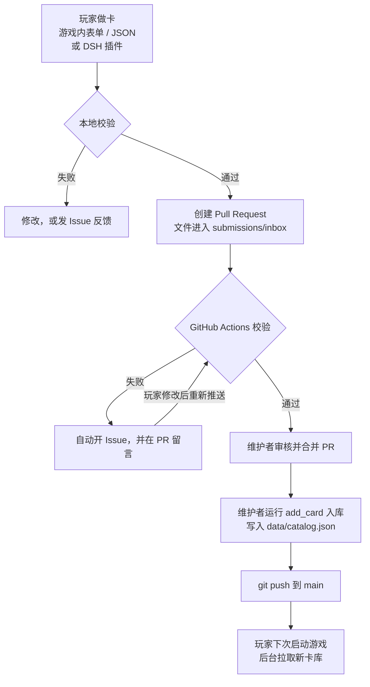
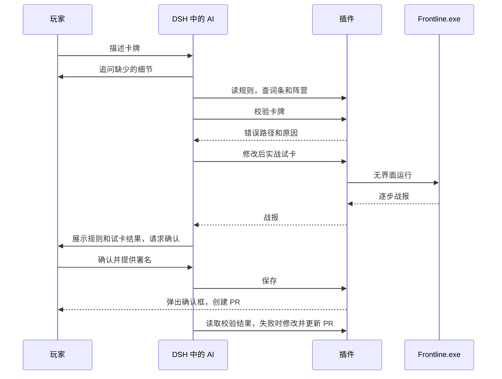

# 巢战运作说明

联机服务器已停用。现在的巢战由三部分组成：装在玩家电脑或手机上的**游戏客户端**、存放卡库和接收投稿的 **GitHub 仓库**，以及可选的 **DSH 制卡插件**。



## 一、游戏客户端

### 卡库从哪里来

| 来源 | 内容 | 使用时机 |
|---|---|---|
| 游戏包内 `data/` | 完整卡库、卡图、音效、表情 | 启动时安装，没有网络也能用 |
| GitHub `main` 分支 | 最新的 `data/catalog.json` | 启动后在后台拉取，连不上时改用 jsDelivr 镜像 |
| 本地档案 | 已安装的卡库、牌组和玩家自己做的卡 | 一直保留 |

### 启动时发生什么

1. 读取游戏包里的卡库并安装。首次启动会校验全部卡牌，之后只处理有变化的部分。
2. 进入游戏后，在后台请求 GitHub 上的卡库，不阻塞界面。
3. 进入卡库页时也会尝试更新，但最多 5 分钟检查一次。文件没变时 GitHub 返回 304，不会重复下载。

### 卡库更新的保护

- **版本号：** 每次入库，`catalog_version` 自动加一。客户端只接受比当前更高的版本，所以重启或读到 CDN 旧缓存都不会回退。
- **逐张校验：** 变化的卡牌都要核对指纹并重新编译。有一张不通过就整批放弃，继续用当前卡库。
- **镜像：** GitHub 优先。主线路 15 秒内没有响应时改用 jsDelivr，镜像有自己的缓存，新卡可能晚一些才到。
- **网络失败：** 不影响游戏，保留现有卡库，60 秒后进入卡库页可重试。

### 右上角的同步状态

| 显示 | 含义 |
|---|---|
| 检查更新中 | 正在连接 |
| 已是最新 | 已连上，没有更新的卡库 |
| 已更新 | 刚刚装好了新卡库 |
| 无法连接更新 | GitHub 和镜像都连不上，继续用现有卡库 |
| 校验失败，已保留当前卡库 | 新卡库有问题，或需要更新客户端 |

前缀“内置卡库”表示当前卡库和安装包相同，“GitHub 卡库”表示已经装了更新的版本。同步不需要登录账号。

### 媒体文件

卡图和音效的文件名就是内容的 SHA-256。查找顺序是：游戏包 → 本地缓存 → 从 GitHub 下载。下载后必须核对哈希才会使用并缓存。表情不随卡库更新，改动表情需要发新客户端。

### 已停用的功能

在线对战、账号、共享牌组、战局统计和网页工坊。单人练习和局域网直连继续可用。

### 客户端更新

0.9.10 起，游戏启动时读取仓库里的 `release/client.json`（GitHub 连不上时走 jsDelivr 镜像），发现新版本会提示，在“设置 → 关于”中更新。

- **Windows：** 游戏从 GitHub Releases 下载新的 exe，核对大小和 SHA-256 后放在原来的文件夹，点“安装并重启”即切换到新版本，旧 exe 自动删除。文件夹不可写时下载到用户目录。
- **Android：** 在浏览器中打开 apk 下载链接，由系统安装器安装。只有用同一签名打包的 apk 才能覆盖安装。
- **签名：** `client.json` 用维护者本机的私钥签名，客户端只接受能用内置公钥验证的版本。仓库成员即使有写入权限，也无法替玩家换掉安装包。
- 0.9.9 及更早的版本没有这个功能，需要手动下载一次 0.9.10。

## 二、玩家如何做卡

| 方式 | 适合 | 需要 |
|---|---|---|
| 游戏内表单 | 已有词条加简单效果组合 | 只要游戏 |
| 游戏内 JSON | 手写复杂效果 | 只要游戏 |
| DSH 插件 | 用自然语言描述卡牌，AI 代写 | DSH Desktop 和自己的 DeepSeek 密钥 |

三种方式生成的是同一种卡牌定义（CardSpec），校验规则也相同。新词条不能由玩家自行创建，需要时发 Issue。

## 三、提交与校验

### 提交

玩家点击“提交”后，浏览器打开 GitHub 新建文件页，文件名和内容已经填好。玩家选择 Propose changes 并创建 PR，需要有 GitHub 账号。内容太长无法放进链接时，游戏会把内容复制到剪贴板，由玩家粘贴。

提交文件是 `submissions/inbox/card-<哈希前12位>.card.json`。想带卡图时，把同名 `.png` 上传到同一个 PR。

### PR 自动校验

工作流 `.github/workflows/validate-submission.yml` 在 PR 改动 `submissions/inbox/` 时运行，检查：

- 只改动了允许的路径，文件名符合规则。
- 卡牌能按游戏规则编译，内容哈希一致。
- 阵营存在，引用的媒体存在，卡库里没有完全相同的卡。
- 卡图是 PNG，不超过 2 MiB，边长不超过 1024。

失败时自动创建 `[报错] 卡牌提交 #<PR> 校验失败` Issue。玩家修改后重新校验，通过后 Issue 自动关闭。

**安全边界：** 工作流需要创建 Issue 的权限，因此使用 `pull_request_target`，只运行主分支上的代码。PR 里的文件只作为数据下载，不会被执行。

### 报错入口

| 场景 | 去向 |
|---|---|
| 游戏内校验失败 | 点击“把报错发到 Issue”，错误和卡牌自动填入 |
| 其他问题或需要新机制 | 设置 → 关于 → 反馈问题 |
| PR 校验失败 | 自动开 Issue |
| DSH 插件反复失败或机制不支持 | AI 生成预填的 Issue 链接，由玩家提交 |

## 四、维护者入库

校验通过的 PR 需要你审核并合并。合并后卡牌还没有进入游戏，还要入库。

### 在 DSH 里审核和发布

有仓库写入权限的成员可以用 DSH 插件完成审核和入库，不需要本地克隆仓库。`chao_approve_pr` 依次检查：最新提交的校验结果、用当前卡库重新校验、合并时锁定提交号，然后用一次提交写入卡库、卡图和投稿目录的移动。别人抢先推送时会基于新版本重做。校验失败的 PR 不能合并，Issue 由维护者自己处理。

### 一键入库

```bash
node tools/library/sync_inbox.mjs
```

脚本会拉取已合并的投稿，列出每张卡的名称、作者和规则并逐张询问，然后检查卡库，最后确认后提交并推送。校验失败的卡会跳过，文件留在投稿目录。

- `--dry-run`：只预览，不写入。
- `--all`：不逐张询问，收录全部通过校验的卡，推送前仍会确认。

投稿目录里的文件不一定都打算收录，使用 `--all` 前请先预览。

需要单独处理某张卡时，用下面的命令：

```bash
git pull
cd server && npm ci && cd ..
node tools/library/add_card.mjs submissions/inbox/card-xxxxxxxxxxxx.card.json --dry-run
node tools/library/add_card.mjs submissions/inbox/card-xxxxxxxxxxxx.card.json
node tools/library/validate_catalog.mjs
git add -A
git commit -m "收录新卡"
git push
```

`add_card` 会写入 `data/catalog.json`、把卡图放进 `data/art/`、更新版本号，并把投稿文件移到 `submissions/accepted/`。推送后玩家下次启动就能拿到。

- 修改已有卡牌：投稿带 `replaces` 字段时自动替换，手动处理时加 `--replace <card_id>`。原作者、卡包和登记时间保持不变。
- 指定卡包：加 `--series <编号>`。
- 不要手工编辑 `data/catalog.json`，指纹由脚本维护。

**只有新增规则或机制时才需要发新客户端。** 旧客户端校验不了新卡时，会保留当前卡库。

## 五、DSH 制卡插件

插件位于 `plugins/chao-cards`，运行在 DeepSeek Harness 里。DSH 负责密钥、模型和对话，插件提供一个技能和一组工具，密钥不经过插件。



| 工具 | 作用 |
|---|---|
| `chao_rules` | 分页读取制卡规则 |
| `chao_card_schema` | 查询卡牌和单个效果的结构 |
| `chao_catalog` | 查询词条、阵营和已有卡牌 |
| `chao_validate_card` | 按 PR 校验的同一套规则检查 |
| `chao_trial_card` | 在真实游戏引擎里试玩 |
| `chao_save_card` | 校验并保存，生成提交链接 |
| `chao_submit_pr` | 用玩家的 `gh` 登录创建 PR，需要确认 |
| `chao_pr_status` | 查询 PR 的校验结果和错误原因 |
| `chao_update_pr` | 把修改后的卡牌推送到自己的 PR，需要确认 |
| `chao_get_card` | 读取已有卡牌的完整定义，用于修改旧牌 |
| `chao_review_queue` | 列出待审核的 PR 和待发布的投稿，需要写入权限 |
| `chao_approve_pr` | 通过并合并校验通过的 PR，然后发布，需要确认和写入权限 |
| `chao_publish_inbox` | 发布已合并但未入库的投稿，需要确认和写入权限 |
| `chao_report_issue` | 生成预填的 Issue 链接，也可确认后直接发布 |

玩家安装并登录 GitHub CLI 后，AI 可以直接创建 PR 和 Issue，每次都会弹出确认框。没有 `gh` 时退回提交链接，由玩家在浏览器里完成。

文件保存在用户目录的 `巢战卡牌` 文件夹：

- `card-xxx.card.json`：用于提交。
- `card-xxx.preview.json`：在游戏“创作工坊 → JSON → 从文件读取”中打开试玩。

规则校验代码和规则文档都打包在插件里。卡牌数据优先在线读取最新版，连不上时用插件自带的版本。游戏规则变化后需要重新打包插件，见 [插件说明](../plugins/chao-cards/README.md)。

## 六、实战试卡

规则校验只能确认卡牌合法，实战试卡用来确认效果对不对。插件在后台启动游戏，不开窗口：

```text
Frontline-0.9.8.exe --headless -- --card-trial=<任务文件> --card-trial-out=<结果文件>
```

游戏用真实的战斗引擎搭局面，把卡放进手牌，再按卡牌类型执行：

| 类型 | 默认流程 |
|---|---|
| 单位 | 打出 → 过回合 → 推进 → 攻击 → 主动能力 → 过回合 → 被消灭 |
| 指令、场地 | 打出 → 过两个回合 |
| 反制 | 伏置 → 对手行动 → 过回合 |
| 总部 | 作为总部开局，过两个回合 |

每一步返回动作状态、战斗日志、双方总部血量、指挥点、手牌和场上单位。当前局面下不合法的动作标记为 `skipped`，不算失败。

AI 可以通过 `scenario` 调整局面，测试条件效果：

| 字段 | 含义 |
|---|---|
| `my_units`、`enemy_units` | 双方初始单位 |
| `credits` | 我方指挥点 |
| `actions` | 自定义步骤：`play`、`move`、`attack`、`activate`、`end_turn`、`enemy_ai`、`kill` |
| `target_index`、`attack_target_index`、`activate_index` | 选择第几个目标或能力 |
| `choices` | 依次回答效果中的选择 |

试卡需要 Windows 版 0.9.8 或更新版本。第一次使用时，AI 会询问 `Frontline-*.exe` 的路径，之后会记住。安卓版不支持。

## 七、发布新版本

| 改动 | 需要做什么 |
|---|---|
| 新卡、修改卡牌、新卡图 | `add_card` 后 `git push`，玩家自动更新 |
| 新规则、新机制、新表情、界面改动 | 导出新客户端，按下面的步骤发布 |
| 规则变化且要用 AI 制卡 | 再运行 `node build.mjs` 和 `npm pack`，发布新版插件 |

发布客户端：

1. 提高 `scripts/client_update.gd` 的 `BASE_BUILD`、`BASE_VERSION` 和 `export_presets.cfg` 的版本号，导出 exe 和 apk。
2. 创建标签为 `v<版本>` 的 Release，上传 `Frontline-<版本>.exe` 和 `Frontline-<版本>.apk`。
3. 签名清单，然后提交并推送 `release/client.json`：

   ```bash
   node tools/publish_client.mjs --version <版本> --build <构建号> --exe build/Frontline-<版本>.exe --apk build/Frontline-<版本>.apk --key ../update_private.pem --notes notes.md
   ```

签名私钥是 `.runtime/update_private.pem`，不在仓库里，请离线备份。私钥丢失后，只能发布带新公钥的客户端，并让玩家手动更新一次。

安卓包使用 `交付/chao-android-release.keystore` 签名，这个文件和同目录的密码文件不在仓库里，请离线备份。丢失后玩家将无法覆盖升级。

## 八、卡库网页

只读页面，托管在 GitHub Pages：<https://xiangwu738-design.github.io/Chao/>。可以查看卡牌（含搜索和筛选）、阵营、词条和表情，不能制作、提交或登录，提交仍然走游戏内表单或 DSH 插件。

- **数据：** 网页打开时直接读取仓库的 `data/catalog.json` 和卡图，GitHub 连不上时改用 jsDelivr 镜像。卡图下载后按文件名校验 SHA-256。
- **更新：** 卡牌推送后最多约 5 分钟显示，不需要重新部署。走镜像时可能晚一些。
- **部署：** 只有 `web/`、`tools/site/` 或工作流本身改动时，`.github/workflows/pages.yml` 才会重新发布。
- **首次开启：** 仓库 Settings → Pages → Source 选 GitHub Actions。

本地组装，输出到 `build/site`：

```bash
node tools/site/build_viewer.mjs
```

## 九、目录速查

| 路径 | 内容 |
|---|---|
| `data/` | 内置卡库和媒体 |
| `submissions/inbox/` | 待入库的投稿 |
| `submissions/accepted/` | 已入库的投稿 |
| `tools/library/` | 入库和校验脚本 |
| `.github/` | PR 校验工作流和 Issue 模板 |
| `plugins/chao-cards/` | DSH 制卡插件 |
| `web/viewer.*`、`tools/site/` | 卡库网页；`web/` 里的其他页面是旧版工坊，只有被卡库网页引用的模块才会发布 |
| `scripts/core/card_trial.gd` | 实战试卡 |
| `server/src/` | 仅保留给校验脚本使用，不需要部署 |
