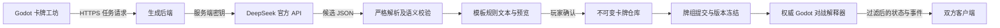

> 类型、反制时机、40张牌组、稀有度、作者与历史显示以 [mechanics-4 补充合同](COUNTERS_AND_VERSIONS.md) 为准。

> 最新制作入口见 [网页工坊](../WEB_WORKSHOP.md)，追加模式见 [Blueprint 合同](CARD_BLUEPRINT.md)，兵种/阶段战斗倍率见 [机制范围](MECHANICS_SUPPORT.md)。当前 capability revision 为 mechanics-5，新增见 [初始属性与阵亡选目标](DYNAMIC_DEATH_EFFECTS.md)。

# Godot 文本生成卡牌接入规范

版本：1.0.0 · 更新：2026-09-24 · 状态：持续维护的接入规范；当前已实现范围见 [机制清单](MECHANICS_SUPPORT.md) 与 [类型和版本](COUNTERS_AND_VERSIONS.md)。

## 0. 给执行 agent 的任务

**当前制卡交互已更新：基础数值由玩家填写、既有词条由玩家选择；普通牌直接校验预览，DeepSeek 主要完善附加效果或理解新词条。** 新生成请求使用 `card_blueprint` 冻结这些字段，精确合同与示例见 [玩家基础配置与 AI 附加机制](CARD_BLUEPRINT.md)。后续澄清和词条恢复必须继承原配置，不能让模型改写基础数值。本文其余完整 CardSpec、DSL、确认发布与版本规则继续适用；无 Blueprint 的旧请求仍保留兼容路径。

实现以下产品链路：**玩家在 Godot 游戏中输入自然语言 → DeepSeek V4.1 Flash 解析意图 → 生成卡牌规则代码 → 校验与预览 → 玩家确认导入 → 在单机和联网对战中执行。**

用户已经确定：Godot、类似 KARDS 的前线卡牌战斗、包含联网对战、不制作预设卡池、官方 DeepSeek API、模型可以继续向玩家追问、词条必须单独登记、已有指令可表达的词条在玩家确认后自动校验登记。本规范将“牌的代码”具体定义为 JSON 声明式程序 CardSpec。它包含可执行操作、触发器和目标引用，由项目自己的解释器执行。

以下为本规范选定、可在后续版本调整的工程默认值，而非用户已经逐项指定的规则：Godot 4.x、生成在对战开始前完成、双人回合制、总部 20 生命、40 张牌组（不含总部）、稀有度对应同名卡上限 4/3/2/1、每轮资源上限 12、v1 效果白名单。实现时不得悄悄改动版本冻结后的规则。

当前已实现网页制卡、官方 DeepSeek 接入、Godot 运行时和云端权威对战。不得为了展示而补造固定卡池。开发测试可使用 `examples/` 中的契约夹具，生产卡库初始为空。

### 0.1 阅读顺序与冲突处理

1. 本文：架构、语义、接口、实施顺序。
2. `card.schema.json` 与 `generation.schema.json`：数据结构。
3. `KEYWORD_REGISTRY.md` 与 `keyword.schema.json`：独立词条登记、版本和展开编译。
4. `COMPILER_PROMPT.md`：模型编译协议。
5. `NETWORK_PROTOCOL.md`：对战网络协议。
6. `ACCEPTANCE_TESTS.md` 与 `examples/`：验收。

字段类型以 Schema 为准，执行行为以本文为准。若发现矛盾，先修复契约并同步测试，不在运行时猜测。所有“必须”“拒绝”均是实现要求；“建议”不影响兼容性。下文包含原始完整设计；现阶段具体边界和验收以 IMPLEMENTATION.md、MECHANICS_SUPPORT.md 及 COUNTERS_AND_VERSIONS.md 为准。

## 1. 设计边界

- 模型负责理解和编译，不负责判定战斗结果、不直接改内存、不生成可以加载执行的 GDScript/C#/JavaScript。
- 卡牌可表达的能力由解释器决定。模型只能组合已经实现的操作；不能靠一段技能说明创造新规则。
- 玩家原文与模型建议保留供编辑；实际展示的规则文本由校验后的 CardSpec 自动生成，避免“描述说抽两张，程序只抽一张”。
- 任意卡牌必须经过同一套导入校验，包括模型生成、本地 JSON 导入、网络接收和旧版本迁移。
- v1 在牌库/牌组界面生成。进行中的对局不等待模型、不接受新定义、不热修改卡牌。未来“对局中造牌”需单独设计费用、暂停及双方可见性协议。
- v1 仅提供双方同意使用自定义卡牌的房间；数值合法不等于竞技平衡。排位、公平定价、社区发布审核不在首版范围。

## 2. 总体架构



部署至少区分三种角色：Godot 客户端、生成后端、权威对战节点。生成后端建议 TypeScript + JSON Schema 校验器 + 持久化数据库；对战节点用与单机相同的 Godot 规则代码。技术栈可替换，但数据和行为契约必须保持一致。

休闲局可由房主运行权威对战节点，双方接受房主可信的前提；独立服务器用于不信任房主的场景。生成后端与对战节点是不同职责，不能误认为把模型接到某个客户端就实现了联网规则同步。

### 2.1 模块职责

| 模块 | 输入 → 输出 | 要求 |
| --- | --- | --- |
| GenerationService | 文本、澄清答案 → 编译结果 | 鉴权、限流、幂等、超时、调用 DeepSeek |
| StrictJsonParser | UTF-8 字节 → JSON 值 | 拒绝重复键、尾随数据、NaN/Infinity、过深输入 |
| CardValidator | CardSpec → ValidationReport | Schema + 语义 + 引用 + 复杂度校验 |
| KeywordRegistry | 独立词条定义 → 已登记可用目录 | 玩家确认后服务器自动校验登记，模型无写入权限 |
| CardCompiler | CardSpec + 冻结词条目录 → CompiledCard | 展开模板、验证参数，固定顺序生成程序 |
| RulesTextRenderer | CardSpec → 中文规则文本 | 固定模板，无模型参与 |
| CardRepository | 验证后的定义 → 不可变版本 | 分配 ID、规范化、哈希、事务保存 |
| CardRegistry | 冻结包 → 可用定义映射 | 对局运行时只读，不接受脚本路径 |
| TargetResolver | 规则目标 + GameState → 有序目标集合 | 不由 UI 或模型决定合法性 |
| EffectInterpreter | 操作 + 上下文 → 领域事件 | 固定指令分派，不使用 eval/Expression |
| BattleEngine | 行动意图 → 新状态与事件 | 权威事务、队列、限制、死亡与胜负结算 |
| MatchServer | 连接身份 + 行动 → 玩家视图 | 验证身份、序列与隐藏信息 |

## 3. 玩家交互流程

### 3.1 创建、澄清、确认

1. 打开“卡牌工坊”，输入一句或多句描述；输入框最多 2,000 Unicode 码点，提交体最多 16 KiB。
2. 显示将发送到 DeepSeek 的内容：玩家描述及这张牌相关的澄清答案，不发送对局私有信息、账号资料或无关聊天。
3. 点“生成草稿”后创建任务，按钮显示处理中，允许取消。关闭面板不自动创建第二次请求。
4. 模型输出 `ok`、`needs_clarification`、`needs_keyword_registration`、`unsupported` 四者之一。`ok` 只表示候选产生，必须再通过服务端校验。
5. 每轮待澄清显示最多 3 个问题，玩家可选择建议答案或填写文字。补充后沿原任务脉络创建新一轮编译任务；仍有疑问可再次追问，不能强行收敛成卡牌。
6. 草稿预览展示名称、类别、部署/行动费用、攻防、关键词、由解释器模板产生的技能文本、补全项，以及结构化 JSON 的折叠高级视图。
7. 明确展示“这是自定义牌，尚无竞技平衡保证”；仅在确认导入时提示一次，不在战斗中反复打断。
8. 玩家点击“确认导入”，提交的是已预览的 `draft_id + draft_hash`；服务端不再次调用模型，事务保存原定义。
9. 玩家可加入牌组、复制为新草稿、导出 JSON。修改生成新修订；旧修订继续服务已有对局与回放。

同一文本并不保证模型每次输出相同。只有已冻结的 CardSpec、词条版本及解释器共同保证相同语义。生成动画结束不等于导入完成。

多轮澄清保存 conversation_id、round、parent_generation_id、原文、每轮问答和 editor_revision；问题 ID 在整个会话唯一。服务端组装历史，不能相信客户端伪造已答历史。每轮可继续追问或进入词条登记，但同一问题已明确回答不得无理由重问。默认每 5 轮暂停显示已确认/未确认内容，玩家可主动继续下一批；这是防止意外连续计费的 UI 节点，不代表“第 5 轮强行生成”。每轮仍使用自己的 request_id 和上游次数预算。

新词条流程独立于卡牌：提出词条 → 向玩家澄清触发/目标/数值/持续时间 → 形成登记预览 → 玩家确认 → 服务器自动进行结构/语义/参数全集/预算校验并事务登记 → 获得固定 id/version → 继续卡牌编译。普通模板无需维护者逐条审核；涉及未实现底层机制时停在 pending_implementation，必须先完成开发。暂停的卡牌不能因词条名字已存在于草案中就被视为可用；状态 approved 表示已经通过系统登记校验，不代表模型有权自行批准。

### 3.2 缺省和歧义的约定

可补全：未写名称、没有指定但明确授权“你来定”的攻防/费用；补全内容进入 `assumptions` 并在确认前展示。未提任何能力的基础单位可用空 abilities。

必须澄清：未说明的“它/他们”指代、关键目标阵营、效果何时触发、带条件的“每次”到底指什么、玩家未授权且缺失的单位数值。“强一点”“合理费用”等相对要求若无约束，也应先澄清。普通效果“抽一张牌”默认牌的控制者抽牌，可作为已公开的语言约定，不额外询问。

必须返回不支持：无限循环、执行代码/联网/读文件、未支持触发器、动态费用公式、复制对手技能、复活、光环、任意条件、沉默、替换事件、在对局中询问模型。“尽量接近”只能是建议，不能替换原意后直接导入。

编辑期间旧任务晚到，不得覆盖新草稿。用 `editor_revision` 与 `request_id` 同时校验。候选失效或取消后仍到达的结果保留到后台审计但不进入当前编辑器。

## 4. DeepSeek 官方 API

### 4.1 已核实的名称

用户称呼 `deepseekv4.1f` 在本方案中对应 **DeepSeek V4.1 Flash**。截至 2026-09-24，官方调用标识为 `deepseek-flash`，见[发布说明](https://api-docs.deepseek.com/news/news260910/)及[更新日志](https://api-docs.deepseek.com/updates/)。不要把用户口语名称原样填入 `model`。

后端配置：

```dotenv
DEEPSEEK_BASE_URL=https://api.deepseek.com
DEEPSEEK_MODEL=deepseek-flash
DEEPSEEK_API_KEY=<仅在服务端注入，不能提交到仓库>
CARD_SCHEMA_VERSION=1.0.0
CARD_RULESET_VERSION=frontline-1
CARD_INTERPRETER_VERSION=interpreter-1
CARD_PROMPT_VERSION=compiler-1
GENERATION_DEADLINE_MS=90000
```

启动时检查必填项；模型名作为配置保留。可用带鉴权的 `GET /models` 做部署连通性检查；找不到配置模型则报告 `MODEL_NOT_AVAILABLE`，不要自动换别的模型。[官方模型列表接口](https://api-docs.deepseek.com/api/list-models/)

### 4.2 请求契约

服务端发起 `POST https://api.deepseek.com/chat/completions`，`Authorization: Bearer <server-key>`，`Content-Type: application/json`。使用非流式 JSON 输出，body 形状如下；`messages` 中的占位内容由服务端模板填充，不能原样发送：

```json
{
  "model": "deepseek-flash",
  "stream": false,
  "thinking": {"type": "disabled"},
  "temperature": 0,
  "max_tokens": 8192,
  "response_format": {"type": "json_object"},
  "messages": [
    {"role": "system", "content": "渲染 COMPILER_PROMPT.md 中的系统模板，包含 JSON Schema"},
    {"role": "user", "content": "JSON.stringify({source_text, clarification_answers}) 的结果"}
  ]
}
```

JSON 模式还要求 prompt 中明确要求 JSON；可能出现空内容或因长度截断。仅在 `choices[0].finish_reason == "stop"` 且 `message.content` 是非空字符串时进入严格解析。JSON 模式不替代 Schema 或游戏语义校验；不读取 `reasoning_content` 作为卡牌。[JSON Output](https://api-docs.deepseek.com/guides/json_mode/)、[Chat Completions](https://api-docs.deepseek.com/api/create-chat-completion/)

`thinking` 与采样参数以部署时官方接口为准；上述为非思考 JSON 编译配置，不能因为接口报错而静默移除限制或切换输出协议。对响应外层与 content 分别限制大小：外层 256 KiB，解码后的 content 32 KiB；CardSpec 正规化后 16 KiB。

### 4.3 密钥与调用约束

正式客户端只访问本项目生成后端，持有短期业务凭据。DeepSeek Key 仅由后端环境变量/密钥管理持有，不写入 Godot 导出包、`project.godot`、卡牌文件、RPC 或日志。

开发者本机可在独立开发后端使用自己的 Key；不提供“把全局项目 Key 填进玩家客户端”的正式路径。生成消耗由该 Key 所属账户承担，后端需按账号限流：默认并发 1、每分钟创建 5 个任务、每天 50 次上游尝试；这些是项目可配置策略，不是 DeepSeek 官方配额。

总截止时间默认 90 秒，单次上游 35 秒；一个任务最多 2 次上游调用，第二次用于一次传输重试或一次 JSON/Schema 修复，二者共享预算。只有明确可重试的 429、5xx、连接失败、超时才做带抖动退避，遵守 `Retry-After` 且不超过剩余截止时间。401/402/模型不可用不重试；业务不支持、语义歧义、平衡限制不自动“修复”。超时可能已计费，不能宣称超时没有调用。

`length`、空 content、JSON 无效允许一次修复机会；修复仍必须保持玩家显式数值和意图。用户取消后不再发起新上游调用；已经发出的请求不保证能撤销计费。持久化任务记录，进程重启后不能无限重发状态不明的请求。

## 5. CardSpec 数据契约

机器可读字段见 [card.schema.json](card.schema.json)。拒绝所有未声明字段；整数不能用数字字符串、布尔值、NaN 或无限大替代。不允许路径、URL、脚本、动态表达式。

| 字段 | 类型/范围 | 语义 |
| --- | --- | --- |
| schema_version | 固定 `1.0.0` | 数据格式 |
| ruleset_version | 固定 `frontline-1` | 游戏行为版本 |
| name | 1–32 码点 | 纯文本显示名，不作为唯一 ID |
| flavor_text | 0–120 码点 | 纯文本风味文字，不产生效果 |
| kind | `unit` / `order` / `counter` | 单位、指令或反制 |
| unit_class | 步兵/坦克/炮兵/战斗机/轰炸机枚举，或 null | 指令必须为 null |
| cost | 1–12 | 打出时部署费用 |
| operation_cost | 0–4 | 单位每次攻击或移动的费用；指令为 0 |
| attack / health | 单位 0–20 / 1–20；指令均为 0 | 基础数值 |
| keywords | 最多 8 个 `{id,version,params}` | 必须引用独立登记且已批准的词条；不接受任意字符串 |
| play_target | null 或 `{side,row}` | 打出时选择一个单位；side=ally/enemy，row=any/support/front |
| abilities | 最多 4 个能力 | 每项 `{trigger,effects}`，每项 effects 1–4 条，全牌合计最多 12 条 |
| tokens | 最多 3 个共享衍生卡模板 | 可有独立词条和能力，见 GENERATED_CARDS.md；不允许嵌套模板定义 |
| appearance | `{emblem}` | 只引用 infantry/tank/artillery/fighter/bomber/order 内置图标 ID |

模型不能写 `card_id`、`revision`、`hash`、作者、签名、可信标志、自动平衡评分。这些是后端字段。文本渲染禁止 BBCode/HTML 解释；名称不允许控制字符，换行只允许在 flavor_text。名称可重复，操作以 ID 和 hash 识别。

单位允许零能力。模板词条展开后，指令至少一个 `on_play` 能力，不能持有其它触发器，也不能带单位专属 builtin 词条。tokens 只能用于本牌 `summon`，没有使用的模板拒绝，引用必须存在且 token_id 唯一；衍生单位只可引用 core.blitz/core.guard，不可含模板词条。关键词引用中同一 id 不得重复，即使版本或参数不同；参数必须与登记项严格一致。

### 5.1 生成结果信封

模型返回符合 [generation.schema.json](generation.schema.json) 的对象：

```json
{
  "status": "ok",
  "card": {"...": "完整 CardSpec，见 examples/valid_unit.json"},
  "assumptions": [],
  "explanation": "对玩家意图的简短解释，不是执行依据"
}
```

以上为形状示意，`...` 不是有效卡牌字段。`needs_clarification` 返回 `{status,questions}`，每个问题为 `{id,question,options}`；`needs_keyword_registration` 返回 `{status,proposals,questions}`，每个 proposal 为 `{name,description,requested_behavior}`；`unsupported` 返回 `{status,reasons,suggestions}`。四种结构互斥，非 ok 时不得夹带可执行 card；禁止用空对象冒充成功。

### 5.2 导入后的存储信封

```text
StoredCard {
  card_id: UUID, revision: positive integer,
  definition_hash: 64 lowercase hex,
  canonical_definition: UTF-8 canonical JSON string,
  definition: CardSpec,
  interpreter_version: "interpreter-1",
  compiler_version: "card-compiler-1",
  keyword_bindings: [{id, version, definition_hash}],
  compiled_program_hash: 64 lowercase hex,
  provenance: {source_kind: "model"|"json_import", source_text?,
    requested_model?, returned_model?, prompt_version?, provider_request_id?},
  owner_id: server-owned user ID, created_at: server UTC timestamp
}
```

provenance 不进入对战包；一般客户端不得读取他人原始文本。`requested_model` 和 `returned_model` 分别记录请求和响应中的名称；provider alias 日后升级不改变已保存的牌。

## 6. DSL 指令与选择目标

### 6.1 触发器

| trigger | 触发点 |
| --- | --- |
| on_play | 从手牌正常打出并支付费用、单位入后援线后；衍生召唤不触发 |
| own_turn_start | 控制者回合开始，资源增长/刷新、单位重置、常规抽牌及其死亡检查完成后 |
| own_turn_end | 控制者主动结束回合后，临时状态到期前 |
| on_death | 单位生命归零从场上移除时，使用离场前的控制者和定义快照 |

单个能力可包含多条有序操作；同一触发器允许多项能力，按定义数组顺序运行。on_death 来源已不在场；指向 self 的操作无目标而失效，校验器直接拒绝这种始终无效的写法。指令仅允许 on_play。

v1 无“每次受伤”“攻击时”“击杀后”“任意单位死亡”等全局监听触发器，无布尔条件和循环；需要这些效果时返回 unsupported，并由开发者在未来版本添加。

### 6.2 目标引用

| target | 集合 |
| --- | --- |
| self | 来源单位，必须仍在场 |
| chosen | 此次打出前玩家选择的单位 ID |
| own_hq / enemy_hq | 能力控制者/其对手的总部 |
| all_friendly_units / all_enemy_units | 当前场上对应阵营所有单位，不含总部；友方包含来源 |
| random_friendly_unit / random_enemy_unit | 从对应当前集合等概率选 1 个；集合按实例 ID 升序 |

登场 `chosen` 使用 `play_target` 或独立能力组 `target`。阵亡、己方回合开始/结束的 `chosen` 使用组内 `target`，默认部署或召唤入场时绑定；显式 `timing=trigger` 才在触发时选择。目标离场不重选；见 [新增合同](DYNAMIC_DEATH_EFFECTS.md)。指令不允许 self。战斗期间不调用模型。

chosen 由客户端提交实例 ID，服务器核对阵营、战线、存活和仍在场。目标不存在则整个行动在扣费前拒绝；合法提交后被前序效果消灭则后续引用失效，不换一个目标、不退款。

目标集合在**每条操作开始时**解析并快照；同一条群体操作同时作用于全部快照目标，按 ID 顺序记录事件，不能先击杀一个就改变本次群伤的目标集合。下一条操作重新读取结算后的场面。随机选择结果由服务器产生并记入日志；客户端不能自行重抽。

### 6.3 操作码

| op | 额外字段 | 确定性语义 |
| --- | --- | --- |
| damage | target, amount:1–10 | 对各目标造成固定伤害；总部/单位均可；技能无反击 |
| heal | target, amount:1–10 | 恢复至目标当前生命上限，不复活，不增加上限 |
| draw | player:owner/opponent, amount:1–3 | 按张抽牌；手牌满则烧牌；牌库空则递增疲劳伤害 |
| modify_stats | 单位 target, attack_delta/health_delta:-5–5, duration | 改攻/最大生命，至少一个 delta 非零 |
| grant_keyword | 单位 target, keyword_id:core.blitz/core.guard, keyword_version:1, duration | 添加已登记 builtin 词条层，不删已有层；v1 不在运行时授予模板词条 |
| gain_kredits | amount:1–3 | 控制者可用资源增加，不超过已有资源槽，不增加资源上限 |
| summon | token_id, amount:1–2, row:固定 support | 依次向控制者后援线召唤模板单位；格子不足则多余部分失效 |
| set_attack_limit | 单位 target, attacks:1–4, duration | 设置目标每个自身控制者回合的主动攻击总上限；不返还已用次数，最后仍有效的层生效 |
| destroy | 单位 target | 直接移除单位并触发阵亡；不是伤害，不反击，不等于放逐 |
| modify_operation_cost | 单位 target, cost_delta:-4–4 且非零, duration | 移动和攻击费用调整；全部层相加后截断至0–4，不改部署费 |

modify_stats/grant_keyword/set_attack_limit/destroy/modify_operation_cost 不接受总部目标。`duration` 为 `battle` 或 `end_of_turn`；后者在**当前正在结算的全局回合**结束时到期，不是来源控制者的下一个回合。任一操作候选集为空时失效，不报错、不重新选择、不回滚已支付行动。三项新增操作的叠加、到期和详细边界见 [机制支持范围](MECHANICS_SUPPORT.md)。

### 6.4 属性修改与关键词

记录基础属性、每层修改和累计伤害 `damage_taken`。`effective_attack = clamp(base_attack + sum(attack_delta),0,30)`，`effective_max_health = clamp(base_health + sum(health_delta),1,30)`，`hp = effective_max_health - damage_taken`。受到伤害增加 damage_taken；治疗降低至最小 0；降低/失去生命上限可能立即死亡。增益/到期不重置伤害。永久层在本次对局中存在，单位离场即清除；同来源也叠加，每次应用拥有独立 modifier_id。

core.blitz@1：单位本回合刚部署/召唤的行动限制解除，不返还已使用的移动或攻击次数。失去临时 blitz 且部署就在当前回合时重新受部署限制；已合法完成的行动不撤销。core.guard@1：只约束普通攻击的合法目标，不自动拦截所有 DSL 技能。两个词条也必须登记为独立定义，不在卡牌里复制定义；对应固定实现 core.blitz.v1/core.guard.v1。

同名关键词按引用计数生效；临时层到期不能删除永久/固有关键词。最大生命和攻击上限截断是此 ruleset 明确的游戏规则，不能拿来替代导入阶段数值范围检查。

## 7. 前线规则基线与事件语义

以下是本项目的简化首版规则，不宣称与 KARDS 的全部现行规则一致。前线独占和推进攻击总部的概念参考[官方前线说明](https://support.kards.com/hc/en-us/articles/360026464712-Battlefield-elements-The-Frontline)。

### 7.1 固定基线

- 总部最大生命 20；后援线每方最多 4 单位；前线最多 5 单位且只能一方占有。战场单位实例 ID 是服务器单调递增整数。
- 双方牌组 40 张，总部另计；同名卡或同卡不同版本共享稀有度上限 4/3/2/1，混合稀有度取最严格上限。自己的牌组和库序对对手保密。
- 随机确定先手；双方洗牌、各抽 4 张，后手再抽 1 张；无换牌。首次进入自己回合正常抽 1 张。
- 初始资源槽/可用资源均 0；每次自己回合开始槽数 +1 至 12，可用资源填满；常规抽 1 张。手牌上限 10。
- 空库每抽一次 fatigue +1，并对自己总部造成该数值伤害；手牌已满的抽牌消耗牌库顶牌并烧毁，不触发卡牌能力。初始化抽牌不产生疲劳，因为牌组长度先已验证。
- 单位打出自动进入自己后援线。格子已满、费用不足、目标无效、错误回合均在扣费前拒绝。指令结算后进弃牌堆。
- 每个单位每回合最多移动一次；默认主动攻击一次，set_attack_limit 可设为1–4次总上限。目标控制者回合开始清空已用攻击计数，修改上限本身不清空。除 blitz 外，当回合部署/召唤单位不能行动；每次移动/攻击均支付当时的有效 operation_cost。
- 步兵/坦克可从后援线进入空前线或己方控制的未满前线，不可后退。步兵移动后锁定本回合全部主动攻击机会，多次攻击不绕过此限制；坦克可移动后攻击。炮兵和飞机不能移动前线。
- 普通地面单位在后援线只能攻击敌前线；在前线可以攻击敌后援线或总部。炮兵/飞机从后援线可攻击任何敌方战线和总部。
- 每次普通攻击，若目标所在战线有 guard，则只能攻击该战线的 guard；攻击总部视为攻击敌后援线，敌后援线 guard 保护总部。guard 不跨战线保护单位。
- 普通攻击双方同时造成攻击力伤害；炮兵攻击不受反击，轰炸机仅遭飞机反击。总部攻击力为 0。技能 damage 不反击，不受 guard 或前线限制。
- 受到攻击的单位无须支付费用/消耗行动次数即可反击；攻击者本次攻击计数在结算前已消耗。
- 对局 active 时任一玩家可主动投降，不要求轮到自己；暂停/未开始/已结束不能投降。公开弃牌仅包含已打出的指令和死亡的非衍生单位；爆手牌烧掉的身份只给其拥有者，衍生单位死亡不进入弃牌库。
- 总部生命可降至 0 以下；在下述胜负检查点，单方死亡判负，同一检查点双方死亡判平局。胜负确定后停止接受行动。

### 7.2 权威结算顺序

每个行动使用工作副本/事务：预检 → 扣费及移动卡牌/设置行动标志 → 产生根事件 → 能力结算 → 派生事件 → 结束结算 → 提交一个新 state_seq。任何非法行动不能修改真实状态、随机游标或日志序号。

能力触发以“事件发生时”场上来源快照为准，顺序为当前回合玩家优先、另一方随后，同阵营按来源实例 ID 升序、同来源按 abilities 下标升序。同一事件队列中的能力来源在后续结算前死亡，已经触发的该能力仍使用快照执行；self 没有存活目标时失效。

根事件捕获能力后，依次执行某能力的各条操作：

1. 解析此操作目标快照，应用全部修改并生成领域事件。
2. 收集所有 hp≤0 单位，按固定顺序一起移除；从离场快照捕获 on_death。
3. 将这些死亡能力排入独立的待处理 FIFO，**本能力剩余操作先继续**。每条操作后都移除死亡单位，故后续 heal 不能救回已移除者。
4. 当前能力全部操作结束，执行待处理死亡 FIFO，并处理其产生的新死亡；死亡队列清空后再执行根事件中下一个能力。
5. 某能力期间首次发现总部 hp≤0，立刻锁定该检查点的胜负（群体操作先全部应用），停止剩余能力/死亡队列，提交结果；死亡触发不允许把已判负总部救回。

正常攻击的双向伤害属于一个原子操作：两边一起受伤，再执行上述死亡检查，不允许被击杀的防守者因此跳过本次反击。on_play 支付、单位入场/指令入弃牌后才触发；打出后来源可以被自己的效果消灭。

回合开始：增长/刷新资源 → 重置当前玩家单位行动标志 → 常规抽牌和胜负检查 → 捕获/结算 own_turn_start。结束：捕获/结算 own_turn_end → 移除本回合所有 end_of_turn 层并批量死亡检查/死亡队列 → 再清理清理阶段新生成且同回合到期的层，直到稳定 → 胜负检查 → 切换玩家并开始回合。清理迭代也计入预算。

### 7.3 执行预算与失败

每牌在模板词条全部展开后：4 abilities、每能力 4 ops、总计 12 ops、3 token 模板。每根玩家行动（包括 end_turn 引发的切换）最多 256 条 DSL 操作、2,048 个领域事件、4,096 次目标访问、512 次随机抽取、32 轮清理；每单位最多 64 附加层（属性、关键词、攻击上限、行动费用合计）；源定义字节上限 16 KiB、展开程序 32 KiB。这些预算是规则版本的一部分。

不能用“超限就忽略剩余效果”产生不同结果。运行期超限是解释器/验证边界错误：回滚整个行动，终止该对局为 `aborted/RULE_BUDGET_EXCEEDED`，双方收到相同故障码；不判某个玩家获胜。保存最小复现日志并隔离相关卡牌版本。静态可判定超限在导入时拒绝。

所有规则数值为整数，禁止用帧时间、系统时间、Dictionary 遍历顺序决定效果。解释器不得执行模型字符串、资源脚本或网络访问。随机只在权威节点发生，结果写入私有完整日志；公共日志不包含牌库洗牌结果。跨版本回放优先使用已记录抽样结果，不能依赖不同 Godot 版本随机算法相同。

## 8. 校验、规范化和冻结

### 8.1 校验顺序

1. 字节/深度/UTF-8 限制：候选 content 32 KiB，嵌套最多 16 层，拒绝非 JSON、重复键和尾随内容。Markdown 围栏不自动剥掉；通过一次修复或报错处理。
2. generation schema：status 对应唯一结构。
3. card schema：未知字段拒绝，不默认填入、不自动转型、不自动删除。
4. 词条：注册表中存在相应 id/version，状态允许新导入；参数数量/类型/范围准确；依赖哈希一致。模板先展开，再对展开程序进行全部后续校验。
5. 语义：触发器与牌种、单位/HQ 目标类型、chosen/play_target、非零修改、token 引用/唯一性/使用情况、总操作预算。
6. 意图：原文显式数值与效果不得静默改写；自动比对可抽取的数值约束，不能自动证明的内容显示预览让玩家确认。不能宣称机器验证完全证明自然语言等价。
7. 规则文本：从展开定义模板生成，测试与解释器同源；不使用模型 explanation 作为技能文本。
8. 单牌沙盒：在固定测试状态运行可触发路径，检查不崩溃和预算；这是检查而非完整的平衡或终止性证明。运行期预算仍必须存在。
9. 生成 canonical_definition、definition_hash、compiled_program_hash；生成私有 draft_id，允许确认导入。

服务端 ValidationReport：`{valid:boolean, errors:[{code,path,message}], warnings:[{code,path,message}]}`。path 为 JSON Pointer；errors 最多 20 项，展示中文 message，内部可另存调试上下文。校验失败不写入可用卡库。

### 8.2 canonical_json_v1

为避免 Godot/后端 JSON 数字与键序差异，冻结时明确统一编码，不简单依赖 `JSON.stringify` 默认参数：

1. 严格解析后仅允许 null、bool、有界整数、字符串、数组、对象；卡牌不允许浮点语义。JSON Schema 的 integer 接受数学上为整数的数字，规范化时转整型；拒绝超出安全整数范围的数值。
2. 所有玩家文本在草稿生成时统一 NFC，换行 CRLF/CR 转 LF；预览展示规范化后的同一版本。CardSpec 的 name/flavor_text（含衍生单位名称）及 KeywordDefinition 的 name/aliases/description 可含非 ASCII；字段名、枚举、ID、参数名均限制为 ASCII。编码器本身支持任意合法 Unicode 字符串，拒绝孤立代理码位；示例编码向量不必是合法 CardSpec。
3. 对象键按 ASCII 码位升序递归排序；数组保留原顺序。keywords 的数组顺序决定模板追加能力的顺序，可能影响效果语义，绝不能为计算 hash 而重排。
4. 无空格/缩进/BOM，数字输出十进制整数（0 不写成 -0/0.0），非 ASCII 输出 UTF-8 原字符；只转义双引号、反斜线和控制字符。换行用 `\n`，制表符用 `\t`，其它 U+0000–001F 用小写十六进制 `\u00xx`；不转义 `/`。
5. `definition_hash = lowercase_hex(SHA256(canonical UTF-8 bytes))`，包含整个 CardSpec（含名称、风味和外观），不含存储信封、时间、作者和模型元数据。

因此改名字也创建新定义哈希。这一 hash 用于内容完整性，不表示可信签名、作者身份或平衡许可。网络对局由服务器自行校验并允许相应卡牌；不能相信客户端声称“有 hash 就批准过”。

### 8.2.1 词条编译与程序哈希

独立词条结构和生命周期见 [KEYWORD_REGISTRY.md](KEYWORD_REGISTRY.md)，机器结构见 [keyword.schema.json](keyword.schema.json)。词条参数仅允许最多 4 个有界整数，模板参数使用对象 `{ "param": "amount" }` 占位，不在字符串中执行表达式。参数替换后重新验证每条指令的具体范围，自动登记前还要证明其允许的全部参数范围不会生成非法指令；这些检查无需模型或维护者口头判断代替。

确定编译顺序：深拷贝 CardSpec → 保留原 abilities 数组顺序 → 按 keywords 数组顺序将 template 词条展开能力追加 → 从展开定义 keywords 中移除 template 引用而保留 builtin → 对每个 token 同样独立展开已登记 template 词条并冻结绑定 → 校验展开定义与总预算。原卡界面仍显示源定义的词条名称和参数；实际效果文本取展开程序。不得既展开模板又额外调用一次模板处理器。

CompiledCard 精确形状：`{compiler_version:"card-compiler-1",definition_hash,keyword_bindings,expanded_definition}`。bindings 收集源卡 keywords、tokens 中关键词及所有 grant_keyword 的引用，按 id 的 ASCII 顺序再按 version 数值升序排序去重，每项 `{id,version,definition_hash}`；第三个字段是该 KeywordDefinition 的 canonical_json_v1 哈希。`compiled_program_hash=SHA256(canonical_json_v1(CompiledCard))`。

公共关键词目录在选牌前公开，`keyword_registry_hash` 是目录中全部已批准 KeywordDefinition 的绑定列表（同样排序）的规范化哈希；它不等于某玩家/对局实际使用的词条子集。实际使用子集留在服务器及对应持牌者视图，防止从独有词条推测未公开牌。v1 不支持绕过登记的私有动态词条。开局冻结目录版本及所有实际引用，更新目录不能修改进行中的对局。

`examples/canonical_vectors.json` 给出跨语言编码向量；Godot 实现必须逐字节通过。Godot 的 JSON 解析行为与严格 JSON/整数验证不能混为一谈，先处理词法约束、再语义检查。[Godot JSON 文档](https://docs.godotengine.org/en/stable/classes/class_json.html)

### 8.3 版本与本地文件

确认导入事务分配 UUID `card_id`、revision 从 1 递增。重复确认同一 draft/hash 返回相同结果；修改时提交基于哪个 revision，旧版本冲突返回 409。只读版本可去重共享内容，但所有权单独保存。

导出文件建议后缀 `.card.json`，形状 `{package_version:"1",definition:CardSpec,definition_hash:string,keyword_bindings:[{id,version,definition_hash}]}`，大小上限 32 KiB。导入时重新校验、解析所有已登记词条并算 hash，不信任文件名、客户端 ID 或签名字段；缺失词条先进入单独登记，不当作已批准定义自动安装；hash 不匹配拒绝。本地缓存 `user://cards/` 仅存自有卡；源 JSON 不能通过 `load()` 当 Godot Resource 加载。缓存原子写临时文件后替换，失败不丢旧版本。

这是“源定义导出包”，不是网络使用的完整冻结包；它不声称自带可信编译产物。导入端在当前明确兼容的规则/编译器版本下重新编译，预览后保存 compiler_version 和 compiled_program_hash。对局冻结包则必须包含这些字段，见联网协议。

未知 schema/ruleset/interpreter 版本拒绝并要求升级，不猜测兼容。旧卡升级使用显式纯函数迁移 → 重新校验 → 预览差异 → 确认生成新修订；原卡和旧回放不改。

## 9. 项目生成后端接口

以下是**本项目应实现的接口**，不是 DeepSeek API。全部需要业务鉴权，资源按 owner_id 隔离。禁止让客户端传递任意模型 endpoint、system prompt、schema URL 或文件路径。

### 9.1 创建生成任务

`POST /v1/card-generations`，请求：

```json
{
  "request_id": "79472750-7813-4218-994b-c2eb7bc527b8",
  "editor_revision": 1,
  "source_text": "一张三费坦克，3攻4血，行动费1，入场抽一张牌。",
  "clarification_answers": [],
  "schema_version": "1.0.0",
  "ruleset_version": "frontline-1"
}
```

澄清轮增加 `parent_generation_id`，答案为 `{question_id,answer}`，问题 ID 必须属于该 owner 的父任务，source_text 沿用原文；修改原文是新的根任务。answers 每轮最多 3 项，每答案最多 500 码点。根请求由服务端分配 conversation_id，后续通过 parent 继承；服务器保存全历史，超过 16 KiB 会话文本时请求玩家确认压缩后的需求摘要，不能静默丢失早期约束。

新客户端还提交 `card_blueprint:{kind,unit_class,cost,operation_cost,attack,health,keywords,name?}`，具体类型和冻结规则见 [CARD_BLUEPRINT.md](CARD_BLUEPRINT.md)。有该字段时，`source_text` 仅描述附加效果；上述示例中的完整自然语言描述属于旧客户端兼容用法。后续轮次省略 Blueprint 时继承，传不同内容时拒绝；普通牌加既有词条直接走草稿预览，不创建模型任务。

返回 202：`{generation_id,conversation_id,round,status:"queued",editor_revision,poll_after_ms:1000}`。同用户相同 request_id + 相同规范请求体返回原任务，内容不同返回 409 `IDEMPOTENCY_CONFLICT`。数据库唯一键保证并发幂等；不能仅依赖客户端防连点。

`GET /v1/card-generations/{id}` 返回 `{generation_id,conversation_id,round,status,editor_revision,result?,error?}`；status 为 queued/running/needs_clarification/needs_keyword_registration/ready/unsupported/failed/canceled。ready 的 result 为 `{draft_id,draft_hash,definition,keyword_bindings,compiled_program_hash,rules_text,assumptions,warnings,expires_at}`；needs_clarification 为 `{questions}`；needs_keyword_registration 为 `{proposals,questions}`；unsupported 为 `{reasons,suggestions}`。客户端初次 1 秒轮询，随后 2 秒，上限总 95 秒并可取消。

`DELETE /v1/card-generations/{id}` 幂等取消 queued/running 任务；已完成返回现有终态，不删除已导入卡。后台终态以原子 compare-and-swap 写入，取消与返回竞争不能复活任务。

### 9.2 确认、编辑、文件导入

- `POST /v1/cards`：`{request_id,draft_id,draft_hash}`；草稿有效期 24 小时，owner 必须匹配。新卡返回 201 StoredCard 公共给自己的视图。
- `POST /v1/cards/{card_id}/revisions`：`{request_id,base_revision,draft_id,draft_hash}`；更新为新修订，不覆盖旧定义。
- `GET /v1/cards/{card_id}?revision=N`：只返回有权访问的冻结版本；公开对战的定义通过对战协议提供。
- `POST /v1/card-imports`：`{request_id,package}`；严格校验导出 package，通过后返回与生成一致的 ready 草稿；仍需预览确认，不允许绕过版本或规则预算。

HTTP 外层大小限制 64 KiB，严格 JSON，未知字段 400；鉴权失败 401、无权限统一 404 防枚举、冲突 409、过期草稿 410、大小 413、语义校验 422、项目限流 429。draft_hash 使用同一 CardSpec hash；若定义在预览后变动必须生成新草稿，不能确认旧 hash。

### 9.3 错误契约

统一 `{error:{code,message,retryable,request_id,details?}}`；details 可包含最多 20 条 `{path,code,message}`，不能回传原始供应商响应、Key 或堆栈。

| code | 处理 |
| --- | --- |
| INPUT_TOO_LONG / INVALID_REQUEST | 修正输入，不请求模型 |
| MODEL_NOT_AVAILABLE | 部署端核对模型，不自动换模型 |
| PROVIDER_AUTH_FAILED / PROVIDER_BALANCE_REQUIRED | 服务端配置/余额问题，玩家重试无效 |
| RATE_LIMITED / GENERATION_TIMEOUT / PROVIDER_UNAVAILABLE | 展示可重试，自动尝试受总预算限制 |
| INVALID_MODEL_OUTPUT / INVALID_SCHEMA | 一次修复后仍失败则返回，不导入 |
| NEEDS_CLARIFICATION / UNSUPPORTED_EFFECT | 对应正常业务结果；UI 不显示成网络崩溃 |
| KEYWORD_NOT_REGISTERED / KEYWORD_VERSION_MISMATCH / INVALID_KEYWORD_PARAMS | 跳转独立词条详情/登记或修改参数，不能按近似词条替代 |
| SEMANTIC_VALIDATION_FAILED / RULE_BUDGET_EXCEEDED | 展示具体字段；不得静默削弱能力 |
| VERSION_MISMATCH / HASH_MISMATCH | 禁止导入/进入对局，重新获取匹配版本 |
| STALE_DRAFT / REVISION_CONFLICT | 保留编辑内容，拉取新状态 |
| IDEMPOTENCY_CONFLICT | 新意图使用新 request_id；原任务不变 |

## 10. Godot 接入合同

建议目录（均待实现）：

```text
client/card_workshop.gd          # 输入、生成状态、澄清、预览、确认
client/generation_client.gd     # 只访问项目后端 HTTPS
cards/card_definition.gd        # 只读定义包装，不是可执行脚本
cards/card_validator.gd         # 与后端相同契约的本地/服务器验证
cards/card_registry.gd          # hash -> 冻结定义
cards/keyword_registry.gd       # (id, version) -> 独立批准词条
cards/card_compiler.gd          # 参数替换和模板展开，产生程序哈希
cards/rules_text_renderer.gd    # 模板文本
battle/game_state.gd            # 可序列化状态/工作副本
battle/target_resolver.gd
battle/effect_interpreter.gd
battle/event_queue.gd
battle/battle_engine.gd
network/match_server.gd
network/player_view.gd
```

接口名称可以调整，职责与参数意义不可省略：

```gdscript
# 这是接口签名示意，不是已经存在的可运行类。
# GenerationClient extends Node
signal generation_updated(request_id: String, result: Dictionary)
signal generation_failed(request_id: String, error: Dictionary)
func generate_card(input: Dictionary) -> String # 返回 request_id，异步完成
func cancel_generation(request_id: String) -> void

# CardValidator extends RefCounted
func validate_definition(definition: Dictionary) -> Dictionary # ValidationReport

# CardRegistry extends RefCounted
func register_frozen(envelope: Dictionary) -> Dictionary # 成功或错误
func get_definition(definition_hash: String) -> Dictionary # 防止外部可变引用

# BattleEngine extends RefCounted
func apply_intent(connection_player: int, intent: Dictionary) -> Dictionary
func legal_targets(player: int, intent: Dictionary) -> Array
func view_for(player: int) -> Dictionary # 必须过滤隐藏信息

# EffectInterpreter extends RefCounted；由 BattleEngine 调用
func resolve_effect(effect: Dictionary, context: Dictionary, state: Dictionary) -> Array
```

HTTPRequest 使用独立节点/请求池，不能在同一个节点同时并发。设置超时、响应上限、禁止任意重定向，检查发起返回值以及 request_completed 的 transport result、HTTP status、UTF-8 与 JSON 内容；失败仍恢复按钮状态。保留 TLS 校验，不使用 unsafe TLS。Godot 端请求总长可为 15 秒，因为生成本身是后台任务，GET 轮询不应悬挂 90 秒。[HTTPRequest 官方文档](https://docs.godotengine.org/en/stable/classes/class_httprequest.html)

持久化只使用 FileAccess 读写数据；不能 `load()` 上传文件、`GDScript.new().source_code`、`Expression.execute`、OS.execute，也不能把模型字符串当 Callable。CardDefinition 可以是开发者编写的 Resource 类，但导入数据仍通过字段赋值构造，不从外部 `.tres/.res` 反序列化。

单机使用同一 validator/interpreter/BattleEngine，区别仅是网络传输。v1 网络动画由已确认快照的差异驱动，完整领域事件留在服务器日志；事件流传输是未来扩展，不能先发送未定义的任意事件对象。单机可使用同一引擎的已确认事件。暂停/跳过动画不影响结算，UI 不自行扣生命、算随机或修正费用。

## 11. 联网集成摘要

完整契约见 [NETWORK_PROTOCOL.md](NETWORK_PROTOCOL.md)，行动 Command、TargetRef 和 ViewerState 字段也由该文件定义。开局冻结 schema、ruleset、interpreter、compiler、公共词条目录、双方私有牌组及引用的 CardSpec/KeywordDefinition/CompiledCard。牌库顺序、对手手牌、未公开的自定义牌定义、私有使用词条子集与生成原文不可广播。

客户端提交行动意图和期望序列号；服务器依实际连接绑定玩家身份，验证后解释执行，返回各自可见的状态。卡牌首次公开时附带冻结定义；必要时客户端先验证再显示。网络校验不能只在生成后端做一次，因为本地文件和修改客户端都可伪造数据。

哈希保证内容一致，不保证发布者身份。直连房主能读取权威节点上的双方牌库，这是房主可信模式的限制；独立服务器用于更强公平性。网络断开处理不能靠重新生成卡牌修复。

## 12. 持久化、观测和隐私

建议表：generation_conversations、generation_jobs、keyword_proposals、keyword_revisions、keyword_registry_snapshots、card_drafts、cards、card_revisions、deck_revisions、matches、match_events。unique(owner_id,request_id)、unique(card_id,revision)、unique(keyword_id,version) 必须由数据库保障；状态转移与导入结果原子写入。

记录 request_id、模型名/响应 ID、prompt/schema/ruleset 版本、调用次数、耗时、finish_reason、token usage、错误码和 card hash。默认日志不记录 Key、Authorization、原始提示词、原始返回、私有牌序、玩家业务令牌。调试原文单独按 owner 权限存放，有明确保留期（建议草稿 7 天、任务 30 天；已导入卡版本随卡保留），允许删除原始描述而保留定义。

完整回放含私有信息，比赛中仅服务器可读；向玩家发布的回放必须按模式脱敏或双方同意全公开。记录初始快照、全部冻结定义、服务器接受的行动、随机结果、领域事件、最终结果及版本。验证回放时比较 canonical_state_hash；计算时排除网络连接号、墙钟、动画状态，但包含所有真实规则状态与随机游标。

服务端不接受客户端指定生成后端 URL 或上游 base_url；运维环境配置除外。UI 中的外观仅采用内置资源 ID，不下载模型提供 URL。后续自定义图片需要单独的资源导入协议，不在 CardSpec 中塞脚本路径。

## 13. Agent 实施顺序与完成条件

### 阶段 A：契约与离线解释器

实现严格解析、Schema/语义验证、canonical_json_v1、KeywordRegistry、CardCompiler、规则文本模板、CardRegistry、EffectInterpreter、前线基础规则。core.blitz/core.guard 作为独立基础词条登记，不能硬编码在每张卡定义中。先用夹具和伪模型完成导入闭环，生产空卡库保持为空。必须通过有效/无效样例与编码向量。

### 阶段 B：生成后端

实现配置、鉴权、多轮会话与独立词条登记、任务持久化、幂等、官方 DeepSeek 适配、四分支响应、一次修复预算、错误码、草稿与确认事务。测试默认使用固定 mock；真实 API smoke test 明确 opt-in、使用环境 Key，并报告实际调用次数。

### 阶段 C：Godot 工坊

实现输入、取消、澄清、预览、规则文本、确认、编辑修订、JSON 导入导出、牌组选择。验证晚到响应、过期草稿、断网、失败后重试与程序重启。

### 阶段 D：联网对战

实现权威服务器、版本冻结、私有定义同步、行动验证、原子结算、断线重连与回放；分别用两个独立 Godot 进程测试。局域网直连与公网可达性分开验收，不能用本机 loopback 成功代替公网测试。

### 阶段 E：交付

交付运行说明、配置样例（无密钥）、依赖锁定、数据库迁移、运行脚本、测试结果、已知限制。验收项详见 [ACCEPTANCE_TESTS.md](ACCEPTANCE_TESTS.md)。必须能完整演示：输入描述 → 得到可执行候选 → 导入 → 加入牌组 → 两端对战出现该卡 → 效果按同一规则结算 → 回放复现。

“接通模型后返回一段 JSON”只完成了链路的一部分；“卡牌显示出来”也不代表技能已实现。不得在汇报中把文档、mock、单机模拟或本机连接测试描述为真实 API / 公网对战已验收。

## 14. 新效果扩展程序

遇到 v1 不支持的需求：保存玩家文本并明确列出不支持片段，给可表达建议，但不自动转换成另一能力。已有 DSL 能表达的新词条按玩家确认后自动登记处理；只有新增底层机制才需要开发 agent 先定义操作/触发器语义和边界 → 更新 schema/ruleset/interpreter 版本 → 实现两端验证与解释器 → 同步规则文本和 prompt → 添加确定性、隐藏信息与预算测试 → 开启新的能力目录 → 允许模型生成。

不得先让模型自由输出新 op 再在运行时猜着执行。纯文本自由度可以大于规则自由度，但两者的差异必须在预览前被指出。

## 15. 官方参考与事实范围

- [DeepSeek 更新日志](https://api-docs.deepseek.com/updates/)：V4.1 Flash 与当前 API 名称。
- [DeepSeek JSON Output](https://api-docs.deepseek.com/guides/json_mode/)：JSON 模式配置、空输出/截断处理。
- [DeepSeek Chat Completions](https://api-docs.deepseek.com/api/create-chat-completion/)：请求响应字段。
- [DeepSeek 模型列表](https://api-docs.deepseek.com/api/list-models/)：部署检查。
- [Godot HTTPRequest](https://docs.godotengine.org/en/stable/classes/class_httprequest.html)、[JSON](https://docs.godotengine.org/en/stable/classes/class_json.html)：客户端基础 API。
- [Godot 高层多人网络](https://docs.godotengine.org/en/stable/tutorials/networking/high_level_multiplayer.html)：ENet、身份与 RPC 基础；公网直连通常需 UDP 端口映射。
- [KARDS 前线](https://support.kards.com/hc/en-us/articles/360026464712-Battlefield-elements-The-Frontline)：前线独占概念。

本文件除这些已注明来源的外部 API 事实外，其余默认数值、DSL、接口和策略均为本项目的设计决定，不是上述产品官方承诺。


### mechanics-11：在场单位数值引用

damage/heal.amount 可用 `{stat:"enemy_unit_count"}`、`{stat:"friendly_unit_count"}`、`{stat:"other_friendly_unit_count"}`；modify_stats.attack_delta / health_delta 也可用这三种引用。支持直接能力、登记词条、衍生卡。敌友相对于效果控制者；统计两条阵线中存活单位，不含总部及隐藏区域，其他友方排除来源单位。

每条效果开始前计数一次，对全体目标使用同一数值。0合法且无操作；已有静态整数范围保持不变，动态计数不截断到静态+5。battle 的增益仅在受影响单位本次在场期间有效；离场后消失，重返战场重新结算登场能力。不是随场面变化实时重算的光环，不支持自定义公式或乘数。例：`{op:"modify_stats",target:"self",attack_delta:{stat:"enemy_unit_count"},health_delta:0,duration:"battle"}`。

轰炸机在防御时不反击（含伏击）；轰炸机主动攻击战斗机时仍受战斗机反击。当前权威对战最低客户端821，LAN协议11。HTTP X-Frontline-Client-Build 使用 ClientUpdate.current_build，不能硬编码旧版本。


总部卡支持 kind=hq；请遵循 RULES_LANGUAGE_SUMMARY 与 HEADQUARTERS.md。血量、draw_rule由玩家固定填写；驻场使用持续光环或回合/单位/指令事件，不能写部署时。play_target只要求有合法目标时选择；无目标可出牌，其他独立效果正常结算。
