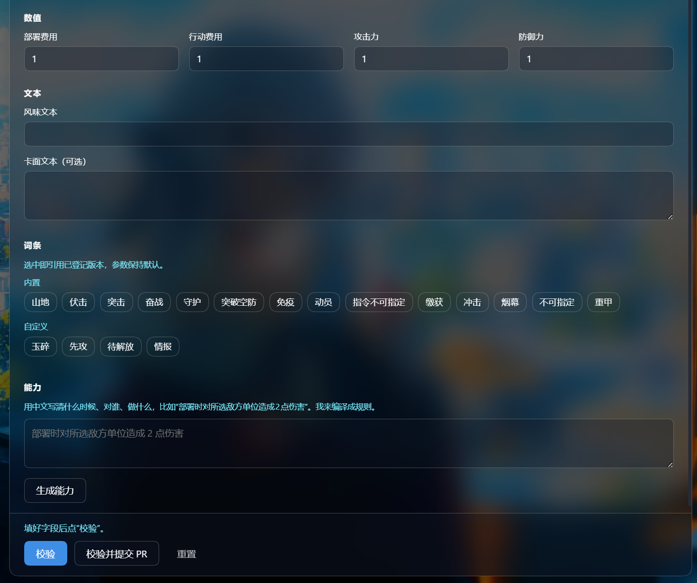

# 巢战 · 做卡工坊（DSH 插件）

在 DeepSeek Harness 里用一个表单把《巢战》卡牌填完：选类型、填数值、挑词条、用中文写能力，点「生成能力」编译成规则，再「校验」，通过后一键开 PR。



## 它能做什么

- 一个面板填完全部投稿字段：名称、署名、类型、兵种、费用、攻防、稀有度、阵营、罪孽、风味文本、卡面文本。
- 词条按钮直接读取已登记的词条，选中即引用版本，不用记 id，也不会有重复条目。
- 能力描述用中文写「什么时候、对谁、做什么」，交给当前模型编译成《巢战》规则 DSL；生成的规则 JSON 可以展开核对。
- 「校验」调用的就是投稿 PR 用的那套校验器，规则只有一份，不会出现「面板说能过、PR 说不行」。
- 「校验并提交 PR」直接用本机 `gh` 登录建 PR；没装 `gh` 时给出手动提交链接。
- 底部固定操作栏：校验结果、每个错误字段的路径、规则文本、定义指纹都在这里，长规则文本单独滚动，不会和表单挤在一起。
- 顶部「更新」按钮：比对 GitHub Release，一键把工坊和制卡插件升到最新（1.1.0 起）。

## 依赖

| 依赖 | 说明 |
|---|---|
| [DeepSeek Harness](https://github.com/deepseek-ai/deepseek-harness) Desktop 0.2.x | 需要带 Web GUI 的版本 |
| `dsh-plugin-chao-cards` ≥ 0.4.0 | 校验、提交、词条目录、规则文本都由它提供，**必须先装** |
| GitHub CLI（可选） | 想在面板里直接开 PR 时用；没装也能拿到手动提交链接 |

本插件自己不实现任何卡牌规则，只调用 `dsh-plugin-chao-cards` 的 `lib/cards.mjs` 和 `lib/github.mjs`。所以卡牌规则更新时升级 chao-cards 就够了，工坊不用动。

## 安装

1. 先装 DSH 制卡插件（chao-cards），步骤见 [plugins/chao-cards](../chao-cards/README.md)，或到 [Releases](https://github.com/xiangwu738-design/Chao/releases) 下载最新的 `dsh-plugin-chao-cards-*.tgz`。
2. 下载本插件：[dsh-plugin-chao-card-studio-1.1.0.tgz](https://github.com/xiangwu738-design/Chao/releases/download/studio-v1.1.0/dsh-plugin-chao-card-studio-1.1.0.tgz)，放到以后不会移动的目录。
3. 在 tgz 所在目录执行（`dsh` 命令先在 DSH 菜单 **Manage dsh Command → Install** 里注册，并用新的终端）：

   ```bash
   dsh plugin --profile desktop add ./dsh-plugin-chao-card-studio-1.1.0.tgz
   ```

4. 重新打开 DSH Desktop，左侧栏会多出「做卡工坊」。

提示：看到「缺少 peer 依赖」是正常的，那些包由 DSH 自己提供。

## 使用

1. 点左侧栏的「做卡工坊」，主区域出现表单。
2. **基本信息** 填名称、署名、类型、稀有度、阵营、罪孽；**数值** 填部署费用、行动费用、攻防；**文本** 填风味文本和卡面文本。
3. **词条** 点选需要的词条，再点一次取消；选中的词条会按已登记版本随卡牌一起提交。
4. **能力** 用中文写清什么时候、对谁、做什么，点「生成能力」；生成的规则 JSON 展开核对，不满意就改描述重新生成。
5. 点「校验」，底部显示规则文本和定义指纹即通过。
6. 点「校验并提交 PR」，在确认框里同意后，PR 会开在巢战仓库的 `submissions/inbox/`。

## 更新

面板顶部状态旁边有「更新」按钮，打开面板时会静默查一次（结果缓存 10 分钟）：

- 两个组件分开判断：**做卡工坊** 看 `studio-v*` 的 Release，**制卡插件** 看 `plugin-v*` 的 Release。
- 有新版时按钮变蓝，显示「更新到 1.1.0」。点一下会：
  1. 把对应的 tgz 下载到 `~/.dsh/chao-card-studio/updates/`；
  2. 交给 DSH 的插件管理器安装并重载插件；
  3. 等插件重新上线后核对版本，按钮回到「已是最新」。
- 卡牌规则、词条、校验器都在制卡插件里，所以「跟着巢战更新」通常就是点一下把制卡插件升到最新。
- 用目录链接安装（`link:`，开发用）时，工坊不会自动覆盖自己的源码目录，按钮会提示手动覆盖目录或 `git pull`。
- 下载或安装失败时按钮显示「更新失败」，点一下重试；也可以照旧手动下载 tgz 安装。

## 面板结构

| 区域 | 内容 |
|---|---|
| 顶部 | 标题、副标题、更新按钮、当前状态（待校验 / 校验通过 / 校验未通过 / 已生成） |
| 基本信息 | 卡牌名称、署名、卡牌类型、兵种、稀有度、阵营、罪孽 |
| 数值 | 部署费用、行动费用、攻击力、防御力 |
| 文本 | 风味文本、卡面文本（可选） |
| 词条 | 内置词条 + 自定义词条，点选即引用 |
| 能力 | 中文描述 → 生成规则 → 可展开的规则 JSON |
| 底部操作栏 | 校验结果 / 错误路径 / 规则文本 / 指纹 + 校验、校验并提交 PR、重置 |

## 实现

- `index.js`（Host 半边）：把 `dsh-plugin-chao-cards` 的校验、提交、目录和「生成能力」挂成同源 HTTP 接口 `/chao-card-studio/api/*`；版本检查与更新走 `/api/version`、`/api/update`。
- `client.js`（Web 半边）：注册 `sidebar.panellist` 入口和 `main` 面板，用 React + 主题 token 渲染表单；只有表单区滚动，头尾固定。
- `cordis.patch.yml`：插件行声明，安装后由 DSH 自动并入 profile。

从源码目录安装（开发用）：

```bash
dsh plugin --profile desktop add ./plugins/chao-card-studio
```

改完 `client.js` 保存即热重载；热重载会把面板退回对话页，重新点开就是新版本。

## 排错

- **打开面板报「找不到已安装的 dsh-plugin-chao-cards」**：先装 chao-cards，再重启 DSH。
- **校验一直不过**：看底部红色错误里的字段路径；常见是名称为空、阵营没选、署名超过 64 字。
- **提交变成给链接**：本机没装 `gh` 或没登录，执行 `gh auth login` 后再试。

## 版本

- **1.1.0**：新增「更新」按钮。比对 GitHub Release，一键更新做卡工坊和制卡插件；开发目录安装会跳过自我更新。卡牌规则随制卡插件一起更新。
- **1.0.0**：首个公开版本。分组表单、词条去重、固定操作栏、半透明面板、状态徽标、规则 JSON 折叠。
